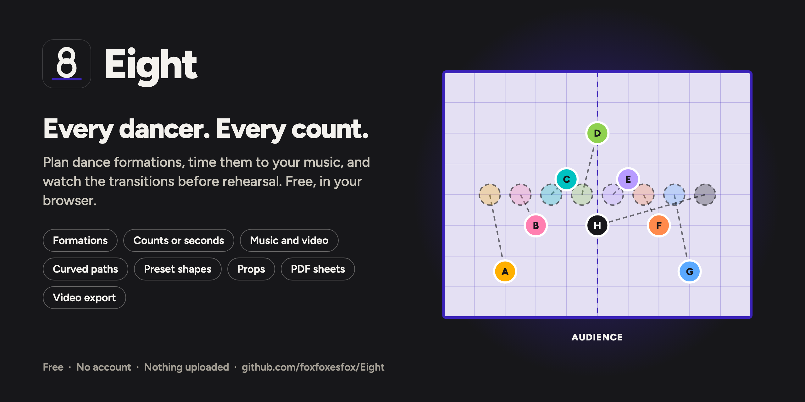

# Eight



A free choreography and formation planner for dancers, choreographers and crews.

Place everyone on the stage, time each formation to your music or video, and watch the transitions play. Then export the plan as a PDF for the wall or a video for the group chat.

Runs in the browser. No account, nothing to install, and everything stays on your device; nothing is uploaded.

How to use it, and answers to common questions: [docs/GUIDE.md](docs/GUIDE.md), which is also the app's Help page. What's new in each version: [CHANGELOG.md](CHANGELOG.md). For sharing outside GitHub there is a poster, [marketing/poster.png](marketing/poster.png), and a 20-second vertical video, [marketing/promo.mp4](marketing/promo.mp4).

## What it does

**Stage**
- Drag dancers, select several with a box or Shift-click, nudge with the arrow keys.
- Ready-made shapes (line, two rows, block, circle, V, pyramid) and group tools: turn, mirror, spread, tighten.
- Curved paths between formations, with a warning when two dancers would walk into each other.
- Props (boxes, risers, chairs, tables) in five shapes that move and animate like dancers.
- Offstage marking, eight colours plus any colour you pick, five mark shapes.
- A workspace you can arrange: resize or hide the side panels, resize the timeline, and share the space between the stage and the video.
- Preview: a full-screen run-through with the formation, count, notes and what comes next.
- Metres or feet, grid spacing, snap step, quarter lines or numbers along the front.
- Dancers' view: the stage seen from the back, the way the dancers face.

**Timeline**
- Trim how long a formation holds and how long everyone takes to move into it.
- Time in seconds or in counts at a tempo, with any number of counts in a bar.
- Snap to counts, half counts, bars, whole seconds, or formation edges and the playhead.
- Right-click a dancer or prop for colour, offstage, back to its last spot, straighten its path or remove; with several selected it acts on all of them.
- Right-click a formation to duplicate it, reset it to the one before, line everyone up, move or delete it.
- Loop one formation, and slide the playback speed anywhere from 0.25× to 1.5×.

**Music and video**
- Add a song (MP3, WAV, M4A, up to 60 MB) with the button or by dropping the file on the page, and see its waveform. Its own row on the timeline holds its volume, replace and remove.
- Or add a video (MP4, MOV, WebM): it plays beside the stage in step with the formations, and can be mirrored.
- Trim the start and end of the song or video by dragging the ends of its waveform; the file itself is never changed.
- A video over 300 MB has no waveform of its own; add its song file and the waveform is drawn from that, with an offset to line it up.

**Export**
- Routine file (`.eight.json`): open, readable, and importable on any device.
- Picture of the current formation (PNG).
- PDF sheets, one or four formations to a page.
- Video of the whole routine with its sound, at 720p or 1080p, with the routine's own video beside it if you want.
- "Back up all" saves every routine in one file, and Import reads it back.

## Your data

Everything is stored in your browser (IndexedDB) on the device you are using. Nothing is uploaded, there is no account and no tracking. Clearing the browser's site data removes your routines, so export the ones you care about. The [guide](docs/GUIDE.md#there-are-no-accounts-what-does-that-mean-for-me) lists what having no accounts means in practice.

Songs and videos stay on the device too. They are not included in an exported routine file, so whoever you send a routine to adds the music themselves.

## Limits worth knowing

- One song or one video per routine. Join several songs into one file first.
- The video export records while the routine plays, so a three-minute routine takes three minutes. Keep the tab open.
- Sharing links and live co-editing are planned and not built yet.
- Built and tested in Chrome. Safari, Firefox and touch devices have had little testing.

## Keyboard

| Key | Does |
|---|---|
| Space | Play or stop |
| Arrow keys | Nudge the selected dancers one snap step (Shift: a tenth of a unit) |
| Ctrl/Cmd + A | Select every dancer |
| Ctrl/Cmd + Z, Shift + Ctrl/Cmd + Z | Undo, redo |
| Escape | Clear the selection |
| Alt while dragging | Ignore snapping |
| Arrow keys on a trim handle | Lengthen or shorten (Shift: a bigger step) |

## Run it yourself

Needs Node 20 or newer.

```bash
npm ci
npm run dev
```

```bash
npm test
```

```bash
npm run e2e
```

`npm test` runs the unit tests. `npm run e2e` builds the site and runs 59 end-to-end checks in headless Chrome: it creates a routine, edits dancers and formations, uses the timeline, adds music and video, and tries every export and import, the way a person would. Add `-- --safari` on a Mac to run them in Safari too; it opens a Safari tab you can close afterwards. To run them from a browser yourself, start `npm run e2e:open` and open the address it prints: the app runs on the left and each check appears on the right as it passes or fails. Reload the page to run them again. Set `CHROME_PATH` if Chrome is installed somewhere unusual.


```bash
npm run build
```

`npm run build` type-checks and writes a static site to `dist/`, which can be hosted anywhere that serves files. There is no server and no environment variables.

### Hosting on Cloudflare Pages

| Setting | Value |
|---|---|
| Build command | `npm run build` |
| Build output directory | `dist` |
| Node version | 22, read from `.node-version` |

The site must be served from `dist`, not from the repository root. The root `index.html` points at TypeScript source that a browser cannot run, so serving it shows a blank page. If you upload by hand instead of connecting the repository, upload the `dist` folder.

## How it is put together

React, TypeScript and Vite. State lives in a Zustand store with Immer patches for undo; storage is Dexie over IndexedDB.

| File | Holds |
|---|---|
| `src/model.ts` | The routine format, timing, path maths, preset shapes, clash detection, import validation |
| `src/store.ts` | The editor store, undo/redo and every edit |
| `src/Editor.tsx` | The editor screen: panels, playback, export window |
| `src/Stage.tsx` | The stage drawing and dragging |
| `src/Timeline.tsx` | The timeline, trimming, snapping, right-click menu |
| `src/audio.ts`, `src/video.ts`, `src/pdf.ts` | Waveforms, video export, PDF export |
| `src/db.ts` | Browser storage |
| `e2e/` | The end-to-end checks and the script that runs them |

Positions are stored in metres and lengths in seconds, whatever units the screen shows. `DESIGN.md` describes the visual system.

## Contributing

Do not commit songs, videos or exported routines; `.gitignore` blocks the common file types. Do not copy code, names, logos or interface assets from other formation apps.
